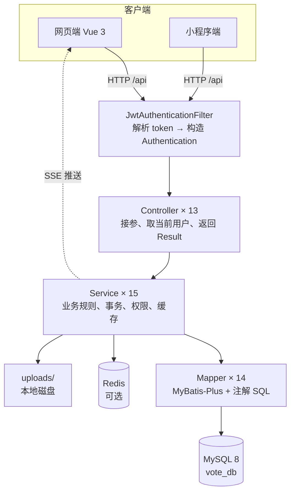
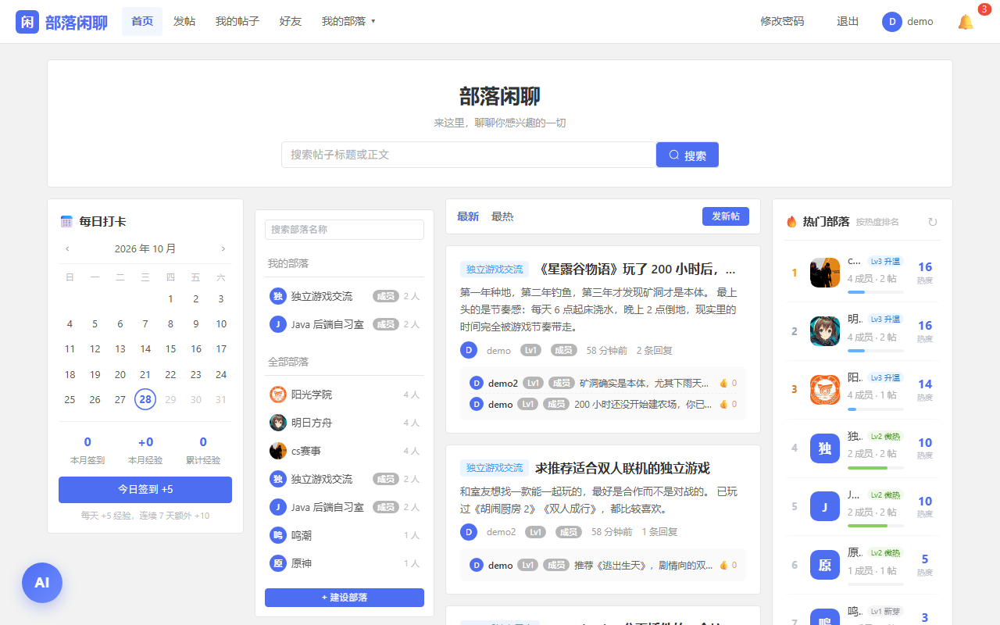

# 部落闲聊 · 兴趣部落社区系统（后端）

一个按**兴趣部落**组织内容的社区服务端：用户可以建部落、发帖、评论点赞、私聊、加好友、每日签到升级，
所有公开发布的内容（帖子、部落、部落资料修改、改名申请）都要经过管理员审核，被举报的内容进入处理队列。

前端仓库：[buluo-frontend](https://github.com/shhowmaker190/buluo-frontend)

- 13 个 REST 控制器，86 个接口
- 14 张表，MySQL 8
- JWT 无状态认证 + SSE 实时推送
- Redis 缓存（不可用时自动降级，业务不中断）

---

## 内容

- [这个项目做了什么](#这个项目做了什么)
- [技术栈](#技术栈)
- [架构](#架构)
- [快速开始](#快速开始)
- [配置](#配置)
- [接口](#接口)
- [数据库设计](#数据库设计)
- [代码结构](#代码结构)
- [实现要点](#实现要点)
- [已知限制](#已知限制)

---

## 这个项目做了什么

**部落是内容的组织单位。** 一个人可以加入多个部落，每个部落有自己的成员、角色（首领 / 副首领 / 成员）
和可被禁言的成员名单。帖子必须发在某个部落里，首页按部落筛选浏览，右侧是热门部落榜（按热度动态分级）。

**发布内容默认不公开。** 发帖、建部落、修改部落资料、申请改名都先落在「待审」状态，管理员在后台逐个处理，
通过后才对所有人可见；驳回必须填写理由，理由通过站内通知回执给提交人。被举报的帖子和部落同样进入待处理队列，
管理员处理完会通知举报人和被举报人。

**互动是双向的。** 帖子下有评论和楼中楼回复、评论点赞；部落之间用私聊联系，私聊支持分享帖子/部落卡片、
未读数、会话单方面删除（我删掉后不影响对方的记录）；好友需要申请并通过。每日签到累计经验，
经验加上发帖、评论的数量决定用户等级（Lv1 萌新 → Lv6 元老）。

---

## 技术栈

| 层 | 选型 | 用途 |
|---|---|---|
| 框架 | Spring Boot 3.2.5 / Spring MVC | Web 容器与依赖注入 |
| 安全 | Spring Security + JWT（`jjwt`） | 无状态认证，token 内含 `sub` 与 `uid` |
| 持久层 | MyBatis-Plus 3.5.9 | 单表 CRUD + 手写复杂 SQL |
| 数据库 | MySQL 8（`vote_db`，14 张表） | 业务数据 |
| 缓存 | Redis（Lettuce）+ 本地缓存兜底 | 热门榜、首页列表，读穿 + 写后失效 |
| 实时 | SSE（`SseEmitter`） | 私聊消息、未读数推送 |
| 图片 | `ImageCompressor`（Java2D） | 头像裁方、正文图等比压缩 |
| 异步 | `ThreadPoolTaskExecutor` | 通知落库与推送不阻塞主流程 |
| 大模型 | DeepSeek → 智谱 → 免费接口 → 本地知识库 | AI 助手，四级降级 |

JDK 17+ 即可运行（开发环境用 21 编译为 17 字节码）。

---

## 架构



一次请求的路径（以发帖为例）：

```
POST /api/post/create
  → JwtAuthenticationFilter   读 Authorization，按 uid 查出用户，放进 SecurityContext
  → PostController.create     取 body 与 auth，调 Service
  → PostService.create        校验部落存在、自己是否成员 → 插入 status=0 → 异步通知全体管理员
  → PostMapper.insert         落库
  → Result.success            统一返回
```

**分层约定**（写新功能时照这个来）：

| 层 | 只做 | 不做 |
|---|---|---|
| Controller | 解析参数、取当前用户、把异常翻译成 `Result` | 业务判断、拼 SQL |
| Service | 业务规则、事务边界、权限校验、缓存读写 | 处理 HTTP 细节 |
| Mapper | 数据库访问 | 业务逻辑 |

---

## 快速开始

### 1. 环境

- JDK 17+
- MySQL 8（无需预建库，脚本会创建）
- Redis 6+（**可选**，不装会自动降级为本地缓存）

### 2. 建库建表

```bash
mysql -uroot -p < sql/vote_db.sql
```

这条脚本创建 `vote_db` 库和 14 张表，**不含任何业务数据**。

### 3. 导入演示数据（可选，强烈建议）

```bash
mysql -uroot -p vote_db < sql/seed.sql
```

导入后可以直接登录看到内容，不用自己注册造数据：

| 账号 | 密码 | 角色 | 能做什么 |
|---|---|---|---|
| `demo` | `Demo@123456` | 普通用户 | 浏览、发帖、评论、点赞、签到、私聊、加好友 |
| `demo2` | `Demo@123456` | 普通用户 | 同上，用来演示两个人互动 |
| `admin_demo` | `Admin@123456` | 管理员 | 额外可进后台：审核帖子/部落、处理举报、禁言 |

数据量：3 个账号、2 个部落、4 篇帖子、6 条评论。

> 演示密码是明文写在脚本里的，**部署到公网前请改掉或不要导入**。脚本用的是固定主键（user 54~56、
> tribe 13~14、post 83~86），只建议在空库上执行，否则会主键冲突。

### 4. 填自己的数据库密码

密码和密钥不进版本库：

```bash
cp src/main/resources/application-local.yml.example src/main/resources/application-local.yml
# 打开 application-local.yml，把 DB_PASSWORD 换成你的 MySQL 密码
```

也可以用环境变量：`DB_PASSWORD`、`JWT_SECRET`、`REDIS_HOST`、`REDIS_PORT`、`CACHE_REDIS_ENABLED`。

### 5. 启动

```bash
./mvnw spring-boot:run
```

看到 `Tomcat started on port 8080` 即成功。验证：

```bash
curl "http://localhost:8080/api/post/list?page=1&size=5"
# {"code":200,"message":"success","data":{"records":[...],"total":4,...}}
```

再验证登录：

```bash
curl -X POST http://localhost:8080/api/auth/login \
  -H "Content-Type: application/json" \
  -d '{"username":"demo","password":"Demo@123456"}'
# data.token 即 JWT，后续请求带 Authorization: Bearer <token>
```

> 如果提示端口被占用，检查是否有环境变量 `SERVER_PORT` 覆盖了配置（Spring Boot 会把
> `SERVER_PORT` / `server.port` 松散绑定），可以用 `env -u SERVER_PORT ./mvnw spring-boot:run` 排除。

---

## 配置

全部配置在 `src/main/resources/application.yml`，敏感项用占位符：

| 配置项 | 作用 | 默认值 |
|---|---|---|
| `server.port` | 服务端口 | `8080` |
| `spring.datasource.url` | 数据库连接 | `jdbc:mysql://localhost:3306/vote_db` |
| `spring.datasource.password` | 数据库密码 | `${DB_PASSWORD:root}` |
| `jwt.secret` | 签名密钥（Base64） | `${JWT_SECRET:开发用默认值}` |
| `jwt.expiration` | token 有效期 | `86400000`（24 小时） |
| `app.upload-path` | 上传根目录 | `uploads`（**部署时改成绝对路径**） |
| `app.upload.max-avatar-size` | 头像大小上限 | 10 MB |
| `app.upload.max-image-size` | 正文图大小上限 | 10 MB |
| `app.upload.avatar-max-width` | 头像裁切边长 | 512 px |
| `app.upload.image-max-width` | 正文图最大宽度 | 1280 px |
| `app.cache.redis.enabled` | 是否启用 Redis | `true`（连不上自动降级） |
| `ai.deepseek.api-key` | DeepSeek Key | 空（空则走免费接口） |
| `ai.zhipu.api-key` | 智谱 GLM Key | 空 |
| `ai.free.enabled` | 免费 AI 通道 | `true` |

`spring.config.import: optional:classpath:application-local.yml` 让本地私有配置可以被覆盖加载，
文件不存在也不报错，所以 clone 下来不配也能启动（只是连不上库）。

---

## 接口

### 统一返回

```json
{ "code": 200, "message": "success", "data": { } }
```

| 情况 | HTTP | body |
|---|---|---|
| 成功 | 200 | `code: 200` |
| 业务失败（参数错、状态不对、重复提交） | 200 | `code: 500` + 可读 message |
| 未登录 / token 过期 | 401 | Spring Security 默认体 |
| 已登录但无权限 | 403 | Spring Security 默认体 |

### 鉴权规则

默认全部接口需要登录，只放行这几类：

```java
.requestMatchers("/api/auth/**", "/api/public/**", "/uploads/**").permitAll()
.requestMatchers(GET, "/api/post/list").permitAll()                                  // 游客可看列表
.requestMatchers(GET, "/api/tribe/list", "/api/tribe/search", "/api/tribe/hot").permitAll()
.requestMatchers(GET, "/api/chat/stream").permitAll()                                // SSE 不能带 header
.anyRequest().authenticated()
```

`/api/chat/stream` 之所以放行，是因为浏览器 `EventSource` 无法设置请求头，token 只能走 URL 参数，
由代码内部手动校验。

### 按模块

| 模块 | 前缀 | 主要接口 |
|---|---|---|
| 认证 | `/api/auth` | `POST /register`、`POST /login` |
| 用户 | `/api/user` | `GET /profile`、`GET /{id}/profile`、`GET /search`、`POST /changePassword`、`POST /avatar`、`POST /posts-visibility` |
| 帖子 | `/api/post` | `GET /list`、`GET /my`、`GET /{id}`、`POST /create`、`DELETE /{id}`、`POST /comment`、`DELETE /comment/{id}`、`POST /comment/like/{id}` |
| 部落 | `/api/tribe` | `GET /hot`、`GET /my/list`、`GET /{id}`、`GET /{id}/members`、`POST /create`、`PUT /{id}`、`POST /{id}/join`、`POST /{id}/leave`、`PUT /{id}/role`、`PUT /{id}/mute`、`DELETE /{id}/member/{uid}` |
| 私聊 | `/api/chat` | `GET /stream`（SSE）、`POST /send`、`POST /share`、`GET /conversations`、`GET /history/{uid}`、`POST /read/{uid}`、`GET /unread`、`DELETE /conversation/{uid}` |
| 好友 | `/api/friend` | `GET /list`、`GET /requests`、`GET /sent`、`GET /check/{uid}`、`POST /request/{uid}`、`POST /handle/{id}`、`DELETE /{uid}` |
| 通知 | `/api/notification` | `GET /list`、`GET /unread/count`、`PUT /{id}/read`、`PUT /read-all`、`DELETE /clear-all` |
| 签到 | `/api/checkin` | `GET /status`、`POST /`（签到） |
| 举报 | `/api/report` | `GET /status`、`POST /`（提交举报） |
| 改名 | `/api/rename` | `GET /latest`、`POST /`（提交申请） |
| 上传 | `/api/upload` | `POST /avatar`、`POST /tribe-avatar`、`POST /image` |
| 后台 | `/api/admin` | 用户、部落、帖子的列表与审核，举报处理，禁言，改名处理（21 个） |
| AI | `/api/ai` | `POST /chat`、`GET /status` |

<details>
<summary>展开全部 86 个接口</summary>

**认证 `/api/auth`（2）**
```
POST /register              注册，角色由服务端固定为 USER
POST /login                 登录，返回 token
```

**用户 `/api/user`（6）**
```
GET  /profile               当前登录用户资料
GET  /{userId}/profile      他人主页
GET  /search                搜索用户
POST /changePassword        修改密码
POST /avatar                修改头像（multipart）
POST /posts-visibility      设置自己的帖子是否公开
```

**帖子 `/api/post`（9）**
```
GET    /list                          列表分页（可按部落、关键词筛选）
GET    /my                            我的帖子
GET    /{postId}                      详情（含热评、楼中楼）
POST   /create                        发帖，落库为待审
DELETE /{postId}                      删除自己的帖子
POST   /comment                       发表评论 / 回复
DELETE /comment/{commentId}           删除评论
POST   /comment/like/{commentId}      评论点赞
DELETE /comment/like/{commentId}      取消点赞
```

**部落 `/api/tribe`（13）**
```
GET    /list  /search                 全部部落 / 按关键词搜索
GET    /hot                           热门榜
GET    /my/list                       我加入的部落
GET    /my/created                    我创建的部落
GET    /{tribeId}                     部落详情
GET    /{tribeId}/members             成员列表（含角色、禁言状态）
POST   /create                        建部落，待审
PUT    /{tribeId}                     改资料，进 pending 待审
POST   /{tribeId}/join                加入
POST   /{tribeId}/leave               退出
PUT    /{tribeId}/role                任命 / 撤销副首领
PUT    /{tribeId}/mute                禁言 / 解除禁言
DELETE /{tribeId}/member/{userId}     移出成员
```

**私聊 `/api/chat`（10）**
```
GET    /stream                        SSE 长连接（token 走 URL 参数）
POST   /send                          发消息
POST   /share                         分享帖子 / 部落卡片
GET    /conversations                 会话列表
GET    /history/{userId}              与某人的历史消息
POST   /read/{userId}                 标记已读
GET    /unread                        未读数汇总
GET    /quota/{userId}                还能发几条（频率限制）
DELETE /conversation/{userId}         删除会话（只删自己一侧）
DELETE /message/{messageId}           删除单条消息
```

**好友 `/api/friend`（7）**
```
GET    /list                 好友列表
GET    /requests             收到的申请
GET    /sent                 发出的申请
GET    /check/{userId}       与某人的好友关系状态
POST   /request/{userId}     发起申请
POST   /handle/{requestId}   同意 / 拒绝
DELETE /{userId}             删除好友
```

**通知 `/api/notification`（7）**
```
GET    /list                 通知列表
GET    /unread               未读通知
GET    /unread/count         未读数（铃铛角标）
PUT    /{notificationId}/read   单条已读
PUT    /read-all                全部已读
DELETE /{notificationId}        删除单条
DELETE /clear-all               清空
```

**签到 `/api/checkin`（2）**
```
GET  /status?year=&month=    某月签到情况与今日状态
POST /                       签到（当天重复会返回友好提示）
```

**举报 `/api/report`（2）**
```
POST /                       提交举报（帖子 / 部落）
GET  /status                 查某个对象我是否已举报
```

**改名 `/api/rename`（2）**
```
POST /                       提交改名申请
GET  /latest                 我最近一次申请的状态
```

**上传 `/api/upload`（3）**
```
POST /avatar                 用户头像（裁方 + 压缩）
POST /tribe-avatar           部落头像
POST /image                  正文图片（等比压缩）
```

**后台 `/api/admin`（21）**
```
GET    /users                        用户列表
GET    /tribes                       全部部落
GET    /tribes/pending               待审部落
GET    /tribes/pending-edits         待审的资料修改
POST   /tribe/approve/{tribeId}      通过部落
POST   /tribe/reject/{tribeId}       驳回部落
POST   /tribe/approve-edit/{tribeId} 通过资料修改
POST   /tribe/reject-edit/{tribeId}  驳回资料修改
GET    /posts                        全部帖子
GET    /posts/pending                待审帖子
GET    /post/{postId}                帖子详情（管理视角）
POST   /post/approve/{postId}        通过帖子
POST   /post/reject/{postId}         驳回帖子（必填理由）
DELETE /post/{postId}                删除帖子
DELETE /comment/{commentId}          删除评论
POST   /restrict-comment             在某帖内禁言
DELETE /unrestrict-comment           解除禁言
GET    /reports                      举报列表
POST   /report/handle/{reportId}     处理举报
GET    /rename-requests              改名申请列表
POST   /rename/handle/{requestId}    处理改名
```

**AI `/api/ai`（2）**
```
POST /chat                   对话（四级降级，按人限流）
GET  /status                 当前可用通道
```

</details>

---

## 数据库设计

`vote_db` 共 14 张表，按业务域分组：

### 用户与社交

| 表 | 关键字段 | 说明 |
|---|---|---|
| `user` | `username`（登录名）、`password`（BCrypt）、`user_no`（6 位唯一编号）、`role`、`exp`、`posts_public` | 等级不存字段，由帖子数×3 + 评论数 + `exp` 实时计算 |
| `friend` | `user_id`、`friend_id` | 双向各存一条，`(user_id, friend_id)` 唯一 |
| `friend_request` | `from_user_id`、`to_user_id`、`status` | 0 待处理 / 1 同意 / 2 拒绝 |
| `chat_message` | `from_user_id`、`to_user_id`、`content`、`is_read`、`from_deleted`、`to_deleted`、`msg_type`、`ref_*` | 删除是单向的：只改自己那一侧的标记 |
| `checkin_record` | `user_id`、`checkin_date`、`exp` | `(user_id, checkin_date)` 唯一，防重复签到 |

### 内容

| 表 | 关键字段 | 说明 |
|---|---|---|
| `post` | `title`、`content`、`user_id`、`tribe_id`、`status`、`reject_reason` | 索引 `(status, created_at)` 支撑「筛选 + 排序」的列表查询 |
| `comment` | `post_id`、`user_id`、`parent_id`、`like_count` | `parent_id` 为空是主楼，否则是楼中楼；`like_count` 是冗余计数 |
| `comment_like` | `comment_id`、`user_id` | `(comment_id, user_id)` 唯一，防重复点赞 |
| `comment_restriction` | `user_id`、`post_id`、`admin_id` | 管理员在某个帖子里禁言某人 |

### 部落

| 表 | 关键字段 | 说明 |
|---|---|---|
| `tribe` | `name`、`creator_id`、`status`、`reject_reason`、`pending_name/description/avatar/status` | 改资料不直接覆盖，先进 `pending_*` 等审核 |
| `tribe_member` | `tribe_id`、`user_id`、`role`、`muted` | 一个用户在一个部落里只有一条记录，`role` 为 LEADER / DEPUTY / MEMBER |

### 治理与通知

| 表 | 关键字段 | 说明 |
|---|---|---|
| `notification` | `user_id`、`type`、`title`、`content`、`is_read`、`biz_type`、`biz_id` | `biz_*` 让通知能跳回对应的帖子/部落 |
| `report` | `reporter_id`、`target_type`、`target_id`、`reason`、`status`、`handler_id`、`handle_note` | 举报处理结果回执 |
| `name_request` | `user_id`、`old_name`、`new_name`、`status`、`reject_reason` | 通过后才真正改 `user.username` |

### 三个设计取舍

**① 计数冗余**：`comment.like_count` 直接存计数，列表排序不用每次 `COUNT(*)`；
点赞/取消时用 `UPDATE ... SET like_count = like_count ± 1` 原子更新，配合唯一索引保证不会算错。

**② 软删除**：私聊消息不物理删除，用 `from_deleted` / `to_deleted` 两个标记区分是哪一方删的。
这样我删掉会话后，对方的历史记录仍然完整。

**③ 待审字段内联**：改部落资料时，新内容写进 `tribe.pending_*`，而不是单开一张「修改申请表」。
因为一个部落同时只能有一条待审修改，用独立表反而是过度设计。

---

## 代码结构

```
src/main/java/com/vote/
├── VoteBackendApplication.java
├── common/         Result、ResultCode        —— 统一返回体
├── config/         Security、JWT、MyBatis、跨域、线程池、密码编码器（9 个）
├── controller/     13 个 REST 控制器
├── service/        15 个业务类（含 CacheService、SseEmitterService、AiService）
├── mapper/         14 个 MyBatis 接口，复杂 SQL 用注解写在方法上
├── entity/         14 个实体，与表一一对应
├── dto/            10 个入参/出参对象（不直接暴露 entity）
├── exception/      全局异常处理
└── util/           ImageCompressor（头像裁方、图片压缩）

src/main/resources/
├── application.yml                    主配置（含占位符）
└── application-local.yml.example      本地私有配置模板

sql/
├── vote_db.sql      建库 + 14 张表
└── seed.sql         演示数据
```

---

## 实现要点

### 1. 审核统一走状态机

发帖、建部落、改部落资料、改名、举报五条链路共用同一套状态：`0 待审 / 1 通过 / 2 拒绝`。
驳回时写入 `reject_reason`，并通过 `NotificationService` 回执给提交人：

```java
// AdminService 里通过/驳回的写法一致
post.setStatus(1);
postMapper.updateById(post);
notificationService.send(post.getUserId(), "POST_APPROVED", "你的帖子已通过审核", ...);
cacheService.evictPostList();   // 通过后列表要重新读，不能等 TTL
```

### 2. 并发重复提交交给数据库

签到、点赞、加好友都没有「先查再插」，而是直接插入并依赖唯一索引：

```java
try {
    commentLikeMapper.insert(like);
    commentMapper.increaseLikeCount(commentId);   // 原子 +1
} catch (DuplicateKeyException e) {
    throw new RuntimeException("你已经点过赞了");
}
```

判断依据交给数据库，避免「两次请求同时通过 if 检查」的竞态。
经验值累加同样用 `UPDATE user SET exp = exp + #{delta}`，不做「查出来 +1 再写回」。

### 3. 列表页把 N+1 压成 2 次查询

帖子列表要给每篇帖子附最多 3 条热评。逐帖查询的话，20 篇帖子就是 1 + 20×3 次。改成一条带窗口函数的 SQL：

```sql
SELECT * FROM (
  SELECT c.*, ROW_NUMBER() OVER (
           PARTITION BY c.post_id
           ORDER BY c.like_count DESC, c.created_at ASC
         ) AS rn
  FROM comment c
  WHERE c.post_id IN (...) AND c.parent_id IS NULL
) t WHERE t.rn <= 3
```

### 4. JWT 同时写 `sub` 和 `uid`

```java
Jwts.builder()
    .setSubject(user.getUsername())
    .claim("uid", user.getId())      // 关键：改名后仍能定位到人
    .claim("role", user.getRole())
```

过滤器优先按 `uid` 查用户，`sub` 只作兜底。这样用户改名之后，**旧 token 依然有效**，
不会出现「改完名被强制登出」。写操作一律用 token 里的 uid 核对数据归属，不信任请求体里的 userId。

### 5. 缓存读穿 + 写后失效 + 降级

热门榜、首页列表这类与用户无关的数据走缓存，读时未命中回源并写回，写操作后主动 evict（不等 TTL）。

Redis 连不上时不抛异常：`CacheService` 捕获连接异常后切到本地 `ConcurrentHashMap` + 过期时间，
业务继续跑，只是多实例之间不再共享缓存。

### 6. SSE 推送

```java
// 连接：token 走 URL，因为 EventSource 不支持自定义 header
@GetMapping(value = "/stream", produces = MediaType.TEXT_EVENT_STREAM_VALUE)
public SseEmitter stream(@RequestParam(required = false) String token) {
    User me = userService.findById(jwtUtils.extractUserId(token));  // 按 uid 定位
    return sseEmitterService.connect(me.getId());
}
```

`SseEmitterService` 用 `Map<Long, SseEmitter>` 维护在线连接，发送时找不到就跳过（对方不在线，
靠下次拉历史补上），并在 `onCompletion` / `onTimeout` 时移除，避免泄漏。

### 7. 上传四道校验

1. 后缀白名单（只允许常见图片格式）；
2. 大小上限（头像/正文各 10 MB，与 `multipart` 上限配合）；
3. 用 Java2D 真正解码一次，确认是图片而不是改了后缀的脚本；
4. 生成 UUID 文件名，落盘前拼绝对路径，防止 `../` 目录穿越。

`app.upload-path` 必须解析成**绝对路径**再读写，否则 `MultipartFile.transferTo(File)` 在相对路径下
会被容器写到临时目录，回头找不到文件。

### 8. AI 助手四级降级

`DeepSeek（有 Key 才用）→ 智谱 GLM-4-Flash → 免费 OpenAI 兼容接口 → 本地知识库`。
任何一级超时或报错自动降级到下一级，最后一级是纯本地规则回答，保证断网也有回应。
按用户限流（每分钟 15 次），相同问题命中缓存直接返回。

---

## 已知限制

1. **没有单元测试**，只有 `contextLoads` 一个启动检查；
2. 密钥靠本地配置文件 / 环境变量，没有接入配置中心或密钥管理服务；
3. 单体应用：没有消息队列，通知靠线程池异步；图片存本地磁盘，没有对象存储；
4. 分页是 `LIMIT offset`，数据量大时深分页会变慢，需要改游标分页；
5. AI 依赖外部免费接口时响应不稳定，事实性内容可能不准（已用本地知识库兜底）。

---

## 截图

<!-- 截图放 docs/screenshots/ 下，然后把下面注释里的表格取消注释 -->

<!--
| 帖子列表 | 后台审核 |
|---|---|
|  |  |
-->
